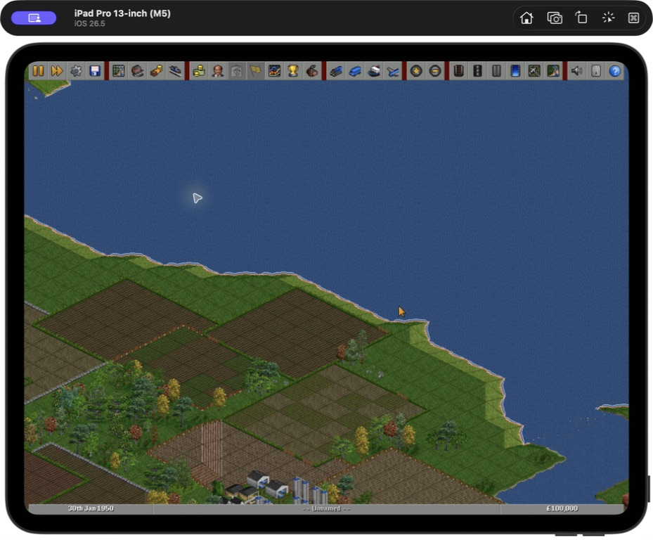

<div align="center">

# OpenTTDPad

### OpenTTD, rebuilt around iPad controls

A native, unofficial iPadOS port of OpenTTD with direct touch, precision tools,
desktop-compatible saves, free offline content, and native pointer and keyboard
support.

**Native arm64 app · iPadOS 17+ · GPLv2 · no original TTD assets required**



</div>

OpenTTDPad keeps the complete upstream simulation and adds an iPad platform
layer: a touch state machine, safe-area-aware native controls, Files integration,
iPad lifecycle handling, free base content, international text, secure online
content, and native MIDI playback. It is not a browser wrapper or an emulator.

> **Project status:** Simulator-validated local beta. Native Simulator and
> unsigned device builds work, and the automated iPad UI suite passes all 21
> invocations across Pro, base, and mini size classes. Physical-device input,
> performance, thermal, audio-route, and sustained lifecycle gates remain open.
> See the [implementation status](docs/STATUS.md) for exact evidence.

## Touch controls

The gesture grammar is small enough to learn once and use everywhere.

| Gesture | Action |
|---|---|
| Tap | Select, activate, or place |
| Drag the map | Pan, with optional momentum |
| Drag a window or active tool | Move the window or build continuously |
| Pinch | Zoom the map around the pinch midpoint |
| Two-finger drag | Pan from anywhere, including over UI |
| Two-finger tap | Open the secondary action or details |
| Double-tap | Open the default action |
| Touch and hold | Enter the offset precision loupe; lift to commit |
| Cancel button / second finger during construction | Abort the active tool safely |

Touch-only hit regions expand undersized controls to at least 44 points without
changing their artwork. The native **OpenTTDPad options** button exposes gesture
response, precision-hold timing, enlarged controls, map momentum, left- or
right-handed control placement, haptics, and replayable touch tips. Mouse,
trackpad, software-keyboard, and hardware-keyboard events stay on their native
input paths instead of being converted into touch gestures. Pencil behavior
remains an explicit physical-device validation gate.

The full behavior contract lives in the
[touch interaction specification](docs/03-touch-interaction.md).

## What is included

- The pinned OpenTTD 15.3 engine, with simulation and save compatibility left intact
- OpenGFX 8.0, OpenSFX 1.0.3, and OpenMSX 0.4.2 for an offline first game
- Native TimGM6mb MIDI playback and bundled dependency notices
- Save import and ZIP export through the Files and share sheets
- Emergency background saves and scene-based iPad lifecycle handling
- Verified HTTPS access to OpenTTD's Online Content catalog
- FreeType, HarfBuzz, ICU, and CoreText fallback for complex and international text
- Landscape, fullscreen layouts for iPad Pro, iPad, and iPad mini

Original Transport Tycoon Deluxe graphics and sound are never bundled. Players
who own them may manage compatible content through OpenTTD's normal data paths.

## Build and run

The build is command-line reproducible and keeps every downloaded source,
archive, and local game file in the gitignored `ref/` directory.

### Requirements

- Apple Silicon Mac
- Xcode with an iOS Simulator runtime and command-line tools selected
- CMake, Ninja, Git, curl, unzip, and `shasum`
- Approximately 10 GB of free space for sources, dependencies, and build output

The currently proven environment is Xcode 26.6 with the iOS 26.5 SDK. The app's
minimum deployment target is iPadOS 17.0.

### Simulator

```sh
git clone https://github.com/chrissotraidis/OpenTTDPad.git
cd OpenTTDPad
./scripts/bootstrap-ios.sh

# Boot an iPad in Simulator, then install and launch the app:
./scripts/run-simulator.sh booted
```

`bootstrap-ios.sh` downloads pinned, freely redistributable dependencies and
content, builds the native arm64 Simulator app, and leaves it at
`build/ios-sim/openttd.app`. You may pass a Simulator UDID to
`run-simulator.sh` instead of `booted`.

### Unsigned device app and IPA

```sh
./scripts/build-device.sh
./scripts/package-ipa.sh
./scripts/verify-release.sh
```

This produces `build/ios-device/openttd.app` and
`build/artifacts/OpenTTDPad-unsigned.ipa`. Installation on an iPad requires your
own Apple signing identity and provisioning profile; the repository does not
ship credentials or a pre-signed binary.

## Verification

OpenTTDPad separates deterministic gesture tests from native Simulator UI tests
so both the control semantics and the UIKit/SDL integration are covered.

| Layer | Current result |
|---|---:|
| Untouched upstream macOS baseline | 96 / 96 |
| Complete downstream host suite | 113 / 113 |
| OpenTTDPad-specific host scenarios | 17 / 17 |
| Native XCTest scenarios | 7 scenarios × 3 iPad classes = 21 / 21 |

```sh
cmake --build build/macos-touch --target openttd_test --parallel 8
ctest --test-dir build/macos-touch --output-on-failure

./scripts/test-simulator-ui.sh
./scripts/verify-release.sh
```

The UI matrix covers a 13-inch iPad Pro, current base iPad, and iPad mini. It
drives continuous map and construction drags, precision hold, Rail and Road
tool selection, native cancellation, first-run coaching, touch preferences,
left/right control placement, notices, save export, and background/foreground
recovery. The runner boots its named device and installs the exact current app
before every suite. Simulator evidence does not stand in for physical multitouch,
trackpad feel, Pencil behavior, thermal performance, or real-device lifecycle
testing.

## Repository map

| Path | Purpose |
|---|---|
| `engine/` | Pinned OpenTTD engine plus the isolated iOS and touch port |
| `os/ios/` | Native app metadata and asset-catalog inputs |
| `scripts/` | Bootstrap, build, package, launch, test, and release checks |
| `tests/ios-ui/` | Native XCTest UI scenarios |
| `patches/` | Reproducible patches to pinned third-party sources |
| `docs/` | Product requirements, architecture, controls, testing, evidence, and status |
| `ref/` | Gitignored downloads, research checkouts, archives, and local game files |

Start with the [documentation index](docs/README.md). The most useful working
documents are:

- [Architecture](docs/02-architecture.md)
- [Touch interaction](docs/03-touch-interaction.md)
- [Build and CI](docs/07-build-and-ci.md)
- [Testing plan](docs/10-testing.md)
- [Implementation status and evidence](docs/STATUS.md)
- [Downstream patch log](docs/PATCHES.md)
- [Third-party notices](THIRD_PARTY_NOTICES.md)

## Licensing and project identity

OpenTTDPad and the OpenTTD engine are distributed under the GNU General Public
License version 2; see [LICENSE](LICENSE). Bundled content and libraries retain
their own compatible licenses, recorded in
[THIRD_PARTY_NOTICES.md](THIRD_PARTY_NOTICES.md) and the
[distribution audit](docs/11-licensing-distribution.md). Corresponding-source
and dependency-manifest packaging is provided by the release scripts.

OpenTTDPad is an independent community project. It is not an official OpenTTD
release and is not affiliated with or endorsed by OpenTTD, Transport Tycoon
Deluxe, or their respective rights holders.

## Contributing

Read the [builder instructions](docs/00-builder-instructions.md) before changing
engine or platform code. Keep changes narrow, preserve upstream gameplay and
save behavior, add deterministic coverage for every gesture boundary, record
edits to pre-existing upstream files in [PATCHES.md](docs/PATCHES.md), and never
commit downloaded sources or game files from `ref/`.
