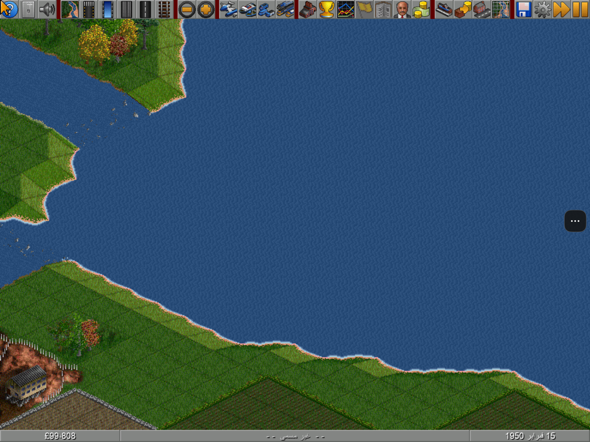

<p align="center">
  
</p>

<h1 align="center">OpenTTDPad</h1>

<p align="center">
  <strong>OpenTTD, native on iPad.</strong><br>
  Build railways, roads, ports and airports with touch-first construction, a precision loupe,
  Apple Pencil, trackpad and keyboard. Desktop-compatible saves and free graphics, sound and music included.
</p>

<p align="center">
  
  
  
  
  
  
  
  <a href="LICENSE"></a>
  <a href="https://github.com/chrissotraidis/OpenTTDPad/releases/tag/v0.2.0"></a>
  <a href="https://github.com/chrissotraidis/padmint"></a>
  <a href="https://discord.gg/xwHfUD2bxW"></a>
</p>

<p align="center">
  <a href="#get-openttdpad">Get OpenTTDPad</a> ·
  <a href="#controls">Controls</a> ·
  <a href="#external-displays-and-ipados-27">External displays</a> ·
  <a href="#current-status">Status</a> ·
  <a href="#frequently-asked-questions">FAQ</a> ·
  <a href="docs/STATUS.md">Evidence log</a>
</p>

<p align="center">
  
</p>

OpenTTDPad is an unofficial iPadOS port of [OpenTTD](https://www.openttd.org/),
the open-source transport simulation based on Transport Tycoon Deluxe. The
OpenTTD 15.3 simulation, economy, pathfinding and save format are untouched.
OpenTTDPad adds the iPad parts: a UIKit scene shell, a gesture system that
turns fingers into OpenTTD actions, Files integration, native MIDI music,
international text, verified HTTPS for Online Content, and reproducible builds.

**AI disclosure:** OpenTTDPad uses substantial AI assistance for code, tests,
documentation, debugging and maintenance. There is no audited percentage of
AI-generated code; build, test and device-acceptance records state what has
actually been checked. This describes OpenTTDPad's workflow, not the authorship
of OpenTTD or its other upstream projects.

> [!IMPORTANT]
> **0.2.0 is the first public preview.** [Download the unsigned IPA](https://github.com/chrissotraidis/OpenTTDPad/releases/tag/v0.2.0)
> and sign it yourself, build it with [PadMint](https://github.com/chrissotraidis/padmint),
> or build from source. The build was installed over an existing copy and
> launched on a physical iPad Pro 12.9-inch (6th generation) running iPadOS
> 27.2.1: it drew the OpenTTD 15.3 title screen and menu at full screen, played
> music and responded to touch. A full touch-only game, Pencil, trackpad,
> keyboard, external displays and long sessions have not yet been checked on
> hardware. See [Current status](#current-status) and the
> [0.2.0 release notes](docs/releases/v0.2.0.md).

## What's new: iPadOS 27 and external displays

Earlier builds launched on iPadOS 27 to a **black screen**: the game was running
and its music played, but SDL created its window outside the app's UIKit scene,
so iPadOS never showed it. OpenTTDPad now carries the same SDL 2.32.10 scene
backport as the other Pad ports
([`patches/sdl2-ios-scenes.patch`](patches/sdl2-ios-scenes.patch)):

- SDL starts only after iPadOS connects the app's scene, and creates its window
  directly on that scene.
- The game window follows its scene when it rotates, resizes, or moves to
  another display, and picks up the new screen's pixel density.
- If iPadOS replaces the scene, the new scene takes over the existing game
  window instead of leaving it blank.
- Orientation comes from the scene, as the iPadOS 27 SDK requires.

## Get OpenTTDPad

OpenTTDPad needs an iPad on iPadOS 17 or later. Nothing else is required to play:
the free OpenGFX, OpenSFX and OpenMSX content is built in, and no original
Transport Tycoon Deluxe data is downloaded or bundled.

Install updates over the existing app. Deleting OpenTTDPad first also deletes
its saves, settings and downloaded content; export saves from the options menu
first if you must reinstall. The install needs about 65 MB of free space.

<details open>
<summary><strong>Download the unsigned IPA</strong></summary>

Download `OpenTTDPad-unsigned.ipa` from the
[0.2.0 release](https://github.com/chrissotraidis/OpenTTDPad/releases/tag/v0.2.0),
check it against `SHA256SUMS`, and sign it with your own Apple ID or developer
account using Xcode, `devicectl` or your usual sideloading tool. The release
also carries the complete corresponding source required by the GPL.

</details>

<details>
<summary><strong>Build it with PadMint</strong></summary>

On an Apple Silicon Mac with Xcode 26 or newer and its iOS platform, choose
**OpenTTDPad** in [PadMint](https://github.com/chrissotraidis/padmint). PadMint
fetches this repository's release, builds the app with the recipe in
[`padmint.json`](padmint.json) and checks the result. There is no game file to
choose. Plan for about 4 GB of free space on the Mac while it builds.

</details>

<details>
<summary><strong>Build from source for a real iPad</strong></summary>

You need an Apple Silicon Mac with Xcode and an iPadOS SDK, CMake, Ninja, Git,
curl and unzip, plus about 10 GB of free space. The bootstrap downloads pinned,
freely redistributable sources and content.

```sh
git clone https://github.com/chrissotraidis/OpenTTDPad.git
cd OpenTTDPad
./scripts/bootstrap-reference.sh
./scripts/build-device.sh
./scripts/package-ipa.sh
./scripts/verify-release.sh
```

The output is `build/artifacts/OpenTTDPad-unsigned.ipa` (the app bundle is
`build/ios-device/openttd.app`). Sign it with your own Apple development
identity and provisioning profile, then install it with Xcode, `devicectl` or
your usual sideloading tool. No credentials or signed binaries are stored in this
repository.

</details>

<details>
<summary><strong>Run it in the iPad Simulator</strong></summary>

```sh
./scripts/bootstrap-ios.sh
./scripts/run-simulator.sh booted
```

Boot any iPad Simulator first, or pass its UDID instead of `booted`.

</details>

## Controls

The gesture vocabulary stays small; context does the clever work.

| Gesture | Result |
|---|---|
| Tap | Select, activate or place |
| Drag the map | Pan, with optional momentum |
| Pinch | Zoom around the point between your fingers |
| Two-finger drag | Pan from anywhere, including over windows |
| Double-tap | Perform the default action |
| Drag with a construction tool | Build continuously |
| Drag a window | Move the window, not the map |
| Two-finger tap | Secondary action or details |
| Add a second finger while building | Abort the active tool safely |
| Touch and hold | Open a 132-point precision loupe; move to aim, lift to commit |
| **Cancel** button | End construction without a stray placement |

Undersized OpenTTD controls get touch targets of at least 44 points without
changing their artwork, and controls can be placed for left- or right-handed
reach. Mouse, trackpad, scroll wheel and hardware keyboard keep their normal
OpenTTD behaviour. The full rules are in the
[touch interaction contract](docs/03-touch-interaction.md) and
[pointer and keyboard notes](docs/04-pointer-keyboard.md).

## External displays and iPadOS 27

OpenTTDPad is a single-scene, landscape, full-screen iPad app. The game window
belongs to that scene: when iPadOS mirrors the iPad or Stage Manager moves the
scene to a connected display, SDL resizes the window to the scene's bounds and
the new screen's scale instead of keeping the iPad panel's size. A second
scene, such as a reconnect after a display change, never starts the game a
second time.

This behaviour matches the fix already shipped in the other Pad ports. On
OpenTTDPad it has been checked on the iPad's own display; a physical external
monitor and Stage Manager have not been tested yet.

## Current status

| Area | State |
|---|---|
| Engine | OpenTTD 15.3; gameplay and save compatibility preserved |
| Physical iPad | iPad Pro 12.9" (6th gen), iPadOS 27.2.1: installs, launches, draws the title screen, music, touch input reaches the game |
| Simulator | iOS 27 iPad Pro, iPad and iPad mini: touch, construction, settings, export and lifecycle tests pass |
| Touch | Direct manipulation, tool-aware drags, precision loupe, 44 pt targets, safe cancellation |
| Content | OpenGFX 8.0, OpenSFX 1.0.3, OpenMSX 0.4.2, TimGM6mb MIDI |
| Files | Save import and ZIP export through Files and the share sheet |
| Lifecycle | Scene-based launch, emergency background saves, state recovery |
| Network | Verified HTTPS to OpenTTD's Online Content catalog |
| Text | FreeType, HarfBuzz, ICU and CoreText fallback, including right-to-left scripts |
| Not yet checked on hardware | A full touch-only game, Pencil, trackpad, keyboard, external display, Bluetooth audio, heat and long sessions |

<details>
<summary><strong>Automated checks</strong></summary>

| Check | Result | Last run |
|---|---:|---|
| Untouched upstream macOS baseline | 96 / 96 | 2026-07-24 |
| Host suite, excluding desktop game regressions | 111 / 111 | 2026-07-24 |
| OpenTTDPad host scenarios | 17 / 17 | 2026-07-24 |
| XCTest UI matrix on iOS 27.0 (7 scenarios × 3 iPad classes) | 21 / 21 | 2026-11-15 |

```sh
cmake -S engine -B build/macos -G Ninja -DCMAKE_BUILD_TYPE=Release
cmake --build build/macos --parallel 8
ctest --test-dir build/macos --output-on-failure --exclude-regex '^regression_' --timeout 300
./scripts/test-simulator-ui.sh
./scripts/verify-release.sh
```

Simulator automation cannot prove multitouch feel, Pencil or pointer feel,
audio routes, heat, real lifecycle reliability or signing. Those claims stay
open until they are shown on hardware and recorded in
[`docs/STATUS.md`](docs/STATUS.md).

</details>

## A look around

<table>
  <tr>
    <td width="50%"></td>
    <td width="50%"></td>
  </tr>
  <tr>
    <td align="center"><strong>Online Content</strong><br>Verified HTTPS catalog access</td>
    <td align="center"><strong>International text</strong><br>HarfBuzz, ICU and CoreText fallback</td>
  </tr>
</table>

## Frequently asked questions

### Do I need the original Transport Tycoon Deluxe?

No. OpenTTDPad ships the free OpenGFX graphics, OpenSFX sounds and OpenMSX music,
so a new game works offline straight away. If you own the original game you can
add its data through OpenTTD's normal data folders; it is never bundled here.

### Can I download a ready-made app?

Yes, as an unsigned IPA on the [releases page](https://github.com/chrissotraidis/OpenTTDPad/releases).
iPadOS only installs apps signed for your device, so sign it with your own Apple
ID or developer account, or let PadMint build a copy for you. There is no App
Store version.

### Are my saves compatible with desktop OpenTTD?

Yes. The save format is OpenTTD 15.3's. Export saves through Files or the share
sheet and open them in desktop OpenTTD 15.3, or import desktop saves the same way.

### Does it run on iPhone?

No. OpenTTDPad targets iPad only, in landscape.

### Does multiplayer work?

OpenTTD's multiplayer code is unchanged, and Online Content downloads work over
verified HTTPS. Joining or hosting a network game from an iPad has not been
tested yet.

### Is this an official OpenTTD release?

No. OpenTTDPad is an independent community port. Report iPad-specific problems
here; report gameplay bugs that also happen on desktop to
[OpenTTD](https://github.com/OpenTTD/OpenTTD/issues).

## Project map

| Path | Purpose |
|---|---|
| `engine/` | Pinned OpenTTD 15.3 plus isolated iOS and touch changes |
| `engine/src/os/ios/` | Scene delegate, overlays, Files, haptics and settings |
| `engine/src/touch/` | Platform-neutral gesture recognizer and hit targets |
| `os/ios/` | App metadata, brand colour and app icon |
| `patches/` | Reproducible patches to pinned SDL sources |
| `scripts/` | Bootstrap, build, package, launch, test and release checks |
| `tests/ios-ui/` | Native XCTest UI scenarios |
| `docs/` | Requirements, architecture, controls, evidence, status and [release notes](docs/releases/) |
| `padmint.json` | PadMint build recipe |
| `ref/` | Gitignored downloaded sources, archives and content |

Start with the [architecture](docs/02-architecture.md), the
[downstream patch log](docs/PATCHES.md) and the
[implementation status](docs/STATUS.md).

## Contributing

Keep changes narrow, preserve upstream gameplay and save behaviour, add
deterministic coverage for gesture boundaries, record edits to inherited
upstream files in [`docs/PATCHES.md`](docs/PATCHES.md), and never commit
downloaded sources or game data from `ref/`. The most useful contributions
right now are physical-iPad test reports: device model, iPadOS version, what you
did, what happened, and a screenshot or log.

## License and identity

OpenTTDPad and the OpenTTD engine are distributed under the
[GNU General Public License version 2](LICENSE). Bundled content and libraries
keep their own compatible licenses, recorded in
[`THIRD_PARTY_NOTICES.md`](THIRD_PARTY_NOTICES.md) and the
[distribution audit](docs/11-licensing-distribution.md).

OpenTTDPad is an independent community project. It is not an official OpenTTD
release and is not affiliated with or endorsed by OpenTTD, Transport Tycoon
Deluxe, or their respective rights holders.
