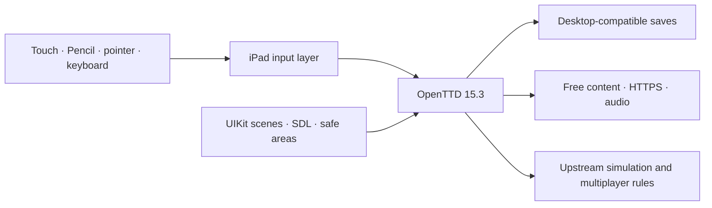

<div align="center">


# OpenTTDPad

**OpenTTD, shaped for iPad.**

A native, unofficial iPadOS port with touch-first construction, precision
tools, desktop-compatible saves, free offline content, and native pointer and
keyboard input.

[](#release-track)
[](#choose-your-route)
[](#proof-not-promises)
[](#proof-not-promises)
[](LICENSE)

**Native arm64 · OpenTTD 15.3 · no original TTD assets required**

[Explore](#a-60-second-tour) ·
[Touch controls](#touch-that-understands-the-game) ·
[Build](#choose-your-route) ·
[Verification](#proof-not-promises) ·
[iPad test gate](#the-last-mile-a-physical-ipad) ·
[Contribute](#contributing)


</div>

> [!IMPORTANT]
> OpenTTDPad is a **public-source preview and Simulator-validated beta**, not a
> hardware-validated 1.0. The native Simulator app and unsigned arm64 device
> build work; automated UI tests pass across Pro, base, and mini iPad classes.
> A real iPad is still required to validate touch feel, Pencil, pointer,
> lifecycle, audio routes, performance, thermals, signing, and save round trips.
> See the [release track](#release-track) and
> [live project status](docs/STATUS.md).

## Choose your route

<details open>
<summary><strong>I want to run OpenTTDPad in Simulator</strong></summary>

### One-command bootstrap

You need an Apple Silicon Mac, Xcode with an iOS Simulator runtime, CMake,
Ninja, Git, curl, unzip, and roughly 10 GB of free space.

```sh
git clone https://github.com/chrissotraidis/OpenTTDPad.git
cd OpenTTDPad
./scripts/bootstrap-ios.sh
./scripts/run-simulator.sh booted
```

`bootstrap-ios.sh` downloads pinned, freely redistributable sources and content
before producing `build/ios-sim/openttd.app`. Boot any iPad Simulator first, or
pass its UDID instead of `booted`.

</details>

<details>
<summary><strong>I want to build the unsigned iPad app</strong></summary>

```sh
./scripts/build-device.sh
./scripts/package-ipa.sh
./scripts/verify-release.sh
```

The reproducible output is `build/artifacts/OpenTTDPad-unsigned.ipa`. Installing
it on hardware requires your own Apple signing identity and provisioning
profile. No credentials or pre-signed binary are stored in this repository.

</details>

<details>
<summary><strong>I want to inspect or contribute to the port</strong></summary>

Start with the [architecture](docs/02-architecture.md), the
[touch contract](docs/03-touch-interaction.md), and the
[current implementation status](docs/STATUS.md). Before changing the engine or
platform boundary, read the [builder instructions](docs/00-builder-instructions.md)
and the [downstream patch log](docs/PATCHES.md).

The highest-value next contribution is evidence: run the
[physical-device matrix](docs/10-testing.md) on a real iPad and record what
actually happens.

</details>

## A 60-second tour

OpenTTDPad keeps the OpenTTD simulation and save format intact. The downstream
work sits at the Apple-platform boundary: scene lifecycle, safe areas, touch
recognition, Files integration, international text, online content, audio, and
reproducible iPad builds.

<table>
  <tr>
    <td width="50%">
      
    </td>
    <td width="50%">
      
    </td>
  </tr>
  <tr>
    <td align="center"><strong>Online Content</strong><br>Verified HTTPS catalog access</td>
    <td align="center"><strong>International text</strong><br>HarfBuzz, ICU, and CoreText fallback</td>
  </tr>
</table>

- **Native, not wrapped.** Arm64 iPad app; no browser, emulator, JIT, ads, or
  private API.
- **Touch is a real input mode.** Gestures resolve to OpenTTD actions through a
  dedicated state machine rather than pretending every finger is a mouse.
- **Playable offline.** OpenGFX, OpenSFX, OpenMSX, and native MIDI provide a
  free first game without commercial Transport Tycoon Deluxe data.
- **Still OpenTTD underneath.** The economy, pathfinding, map generation,
  multiplayer determinism, saves, mouse, trackpad, and keyboard remain familiar.

<details>
<summary><strong>See how the port stays isolated from the simulation</strong></summary>



iPad-specific work stays in dedicated platform and touch components. Changes
to files inherited from upstream are recorded in
[`docs/PATCHES.md`](docs/PATCHES.md).

</details>

## Touch that understands the game

The gesture vocabulary stays small; context does the clever work.

<details open>
<summary><strong>Move around the world</strong></summary>

| Gesture | Result |
|---|---|
| Tap | Select, activate, or place |
| Drag the map | Pan, with optional momentum |
| Pinch | Zoom around the point between your fingers |
| Two-finger drag | Pan from anywhere, including over UI |
| Double-tap | Perform the default action |

</details>

<details>
<summary><strong>Build without fighting the interface</strong></summary>

| Gesture | Result |
|---|---|
| Drag with a construction tool | Build continuously |
| Drag a window | Move the window, not the map |
| Two-finger tap | Secondary action or details |
| Add a second finger while constructing | Abort the active tool safely |
| Native Cancel control | End construction without a stray placement |

</details>

<details>
<summary><strong>Reach small or exact targets</strong></summary>

Touch-only hit regions expand undersized controls to at least 44 points without
changing their artwork. Touch and hold opens a 132-point precision loupe; move
to aim, then lift to commit. Controls and hints can be placed for left- or
right-handed reach.

</details>

Mouse, trackpad, software-keyboard, and hardware-keyboard events retain their
native paths. Read the complete
[touch interaction contract](docs/03-touch-interaction.md).

## What works today

| Area | Current state |
|---|---|
| Engine | Pinned OpenTTD 15.3; gameplay and save compatibility preserved |
| App | Native arm64 Simulator and unsigned arm64 iPad device bundles |
| Touch | Direct manipulation, tool-aware drags, precision mode, 44 pt targets, safe cancellation |
| Content | OpenGFX 8.0, OpenSFX 1.0.3, OpenMSX 0.4.2, TimGM6mb MIDI |
| Files | Save import and ZIP export through Files and share sheets |
| Lifecycle | Scene-based launch, emergency background saves, state recovery |
| Network | Verified HTTPS access to OpenTTD's Online Content catalog |
| Text | FreeType, HarfBuzz, ICU, and CoreText fallback |
| Layout | Landscape fullscreen on iPad Pro, iPad, and iPad mini |

Original Transport Tycoon Deluxe graphics and sounds are never bundled. Players
who own them may manage compatible content through OpenTTD's normal data paths.

## Proof, not promises

Last fully rerun on **2026-07-24**:

| Layer | Proven result |
|---|---:|
| Untouched upstream macOS baseline | 96 / 96 |
| Current host suite, excluding desktop game regressions | 111 / 111 |
| OpenTTDPad-specific host scenarios | 17 / 17 |
| Native XCTest UI matrix | 7 scenarios × 3 iPad classes = 21 / 21 |

The UI matrix runs the exact current app on an iPad Pro 13-inch, base iPad, and
iPad mini Simulator. It covers first-run coaching, continuous map and
construction drags, Rail and Road tool selection, precision hold, cancellation,
44-point controls, left/right placement, notices, save export, and lifecycle
recovery.

```sh
cmake -S engine -B build/macos -G Ninja -DCMAKE_BUILD_TYPE=Release
cmake --build build/macos --parallel 8
ctest --test-dir build/macos --output-on-failure \
  --exclude-regex '^regression_' --timeout 300

./scripts/test-simulator-ui.sh
./scripts/verify-release.sh
```

<details>
<summary><strong>What Simulator evidence does not prove</strong></summary>

Simulator automation cannot validate physical multitouch arbitration, Pencil
or pointer feel, real speaker and Bluetooth routes, battery and thermal
behavior, real-device lifecycle reliability, Apple signing, or App Store
distribution. Those claims stay open until they are demonstrated on hardware.

</details>

The complete command log, result-bundle paths, screenshots, and known limits
live in [`docs/STATUS.md`](docs/STATUS.md).

## Release track

| Milestone | State | Exit condition |
|---|---|---|
| Public source preview | **Ready** | Publish this tree with its source, notices, build scripts, and honest beta label |
| Simulator beta | **Passed** | Native build, launch, host suite, and 21/21 UI matrix |
| Unsigned device candidate | **Built, install unverified** | Sign and install the exact artifact on hardware |
| Physical iPad beta | **Open** | Required device/input/lifecycle/audio/performance checks pass |
| Public 1.0 | **Not ready** | EXP-10 usability, required device matrix, licensing review, and all G5 metrics pass |

This repository is ready to be shown publicly **as source and a Simulator
beta**. It is not yet ready to promise a polished physical-iPad release.

## The last mile: a physical iPad

When an iPad is available, the first hardware pass should be narrow and
evidence-led:

- [ ] Sign and install the exact unsigned device candidate.
- [ ] Launch offline; create a map; save; force-quit; reopen and load.
- [ ] Build a road route and a rail route using touch only.
- [ ] Check pinch, two-finger pan/tap, precision hold, Cancel, and simultaneous
  touches for feel and accidental actions.
- [ ] Test Pencil, mouse/trackpad, wheel, hardware keyboard, and software text
  entry.
- [ ] Run ten background/foreground cycles, then verify the save again.
- [ ] Check speakers, headphones/Bluetooth, interruption recovery, heat, and
  sustained performance.
- [ ] Export the iPad save and open it in desktop OpenTTD.

The exact acceptance cases are in the
[testing plan](docs/10-testing.md). Record device model, iPadOS version,
observed behavior, logs, and screenshots in
[`docs/STATUS.md`](docs/STATUS.md); do not convert a partial pass into a full
hardware claim.

## Repository guide

| Path | Purpose |
|---|---|
| `engine/` | Pinned OpenTTD engine plus isolated iOS and touch changes |
| `os/ios/` | App metadata, brand color, and downstream app icon |
| `scripts/` | Bootstrap, build, package, launch, test, and release checks |
| `tests/ios-ui/` | Native XCTest UI scenarios |
| `patches/` | Reproducible patches to pinned third-party sources |
| `docs/` | Requirements, architecture, controls, evidence, and status |
| `ref/` | Gitignored sources, archives, and local game files |

<details>
<summary><strong>Open the documentation map</strong></summary>

- [Documentation index](docs/README.md)
- [Architecture](docs/02-architecture.md)
- [Touch interaction](docs/03-touch-interaction.md)
- [Pointer and keyboard](docs/04-pointer-keyboard.md)
- [Build and CI](docs/07-build-and-ci.md)
- [Roadmap and release gates](docs/09-roadmap.md)
- [Testing plan](docs/10-testing.md)
- [Licensing and distribution](docs/11-licensing-distribution.md)
- [Implementation status](docs/STATUS.md)
- [Downstream patch log](docs/PATCHES.md)

</details>

## Contributing

Keep changes narrow, preserve upstream gameplay and save behavior, add
deterministic coverage for gesture boundaries, record edits to inherited
upstream files in [`docs/PATCHES.md`](docs/PATCHES.md), and never commit
downloaded sources or game data from `ref/`.

Useful contributions include physical-device test evidence, accessibility
review, documentation fixes, reproducible bug reports, touch boundary tests,
and small upstream-friendly platform patches.

## License and identity

OpenTTDPad and the OpenTTD engine are distributed under the
[GNU General Public License version 2](LICENSE). Bundled content and libraries
retain their own compatible licenses, recorded in
[`THIRD_PARTY_NOTICES.md`](THIRD_PARTY_NOTICES.md) and the
[distribution audit](docs/11-licensing-distribution.md).

OpenTTDPad is an independent community project. It is not an official OpenTTD
release and is not affiliated with or endorsed by OpenTTD, Transport Tycoon
Deluxe, or their respective rights holders.
