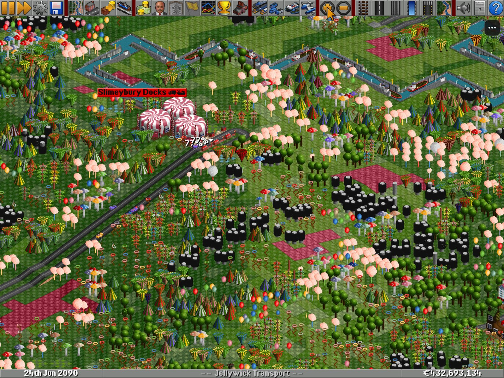
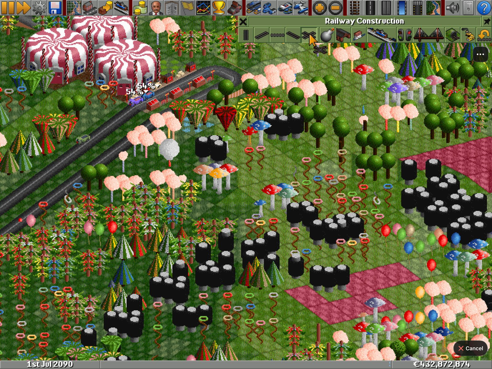
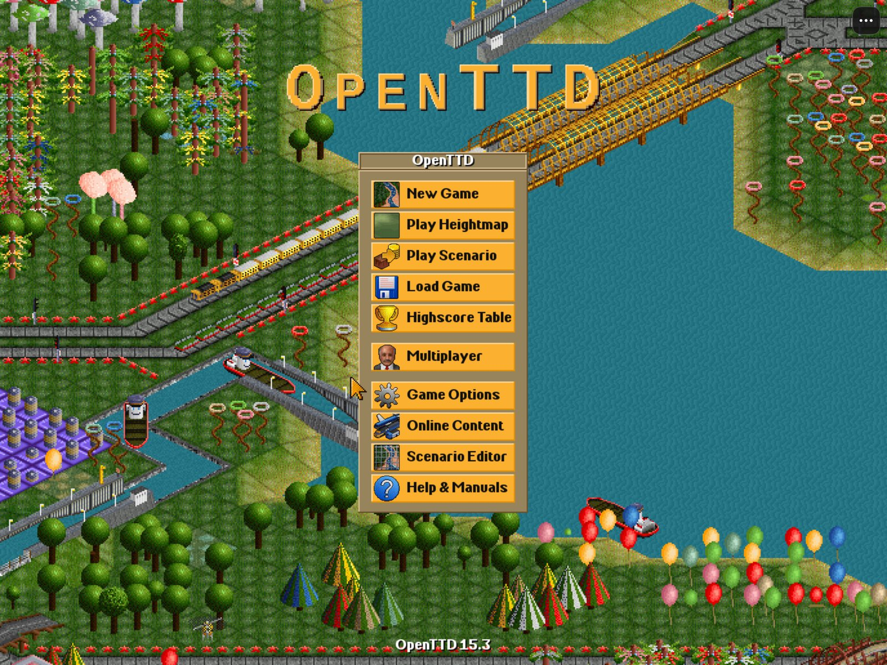
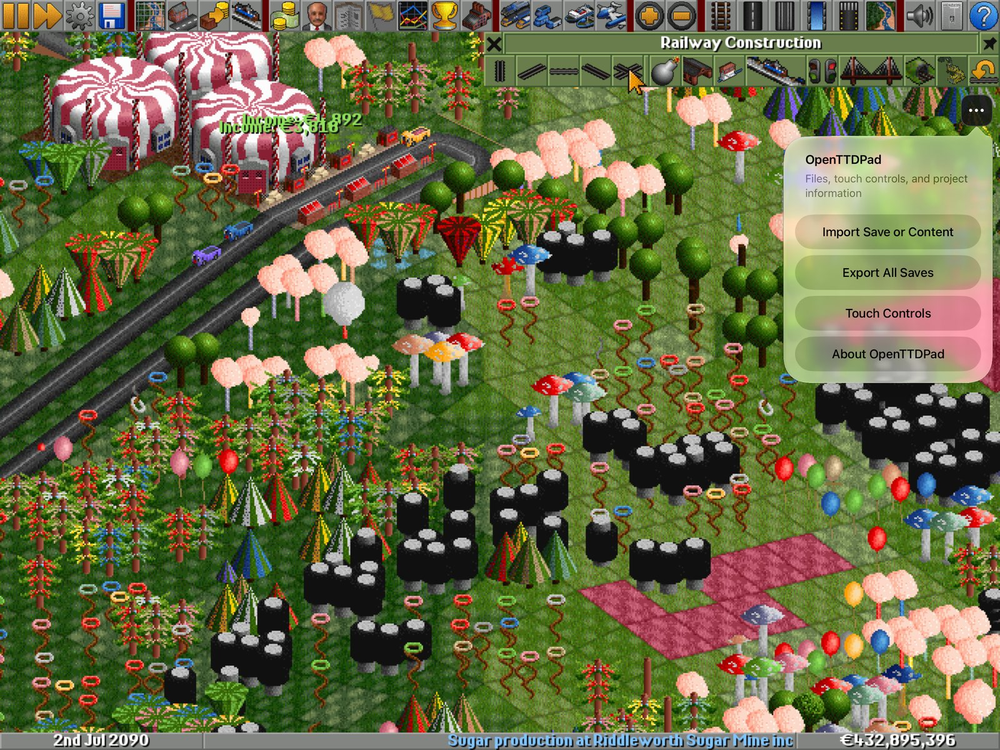
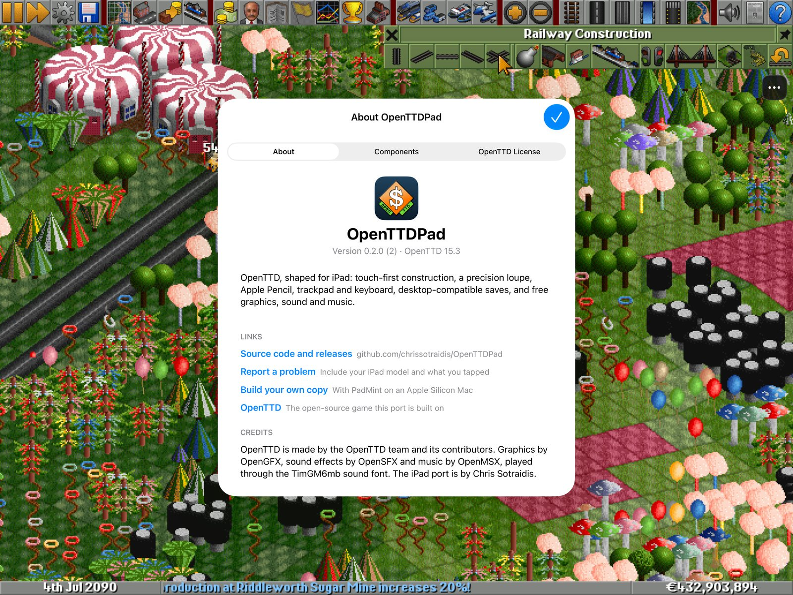
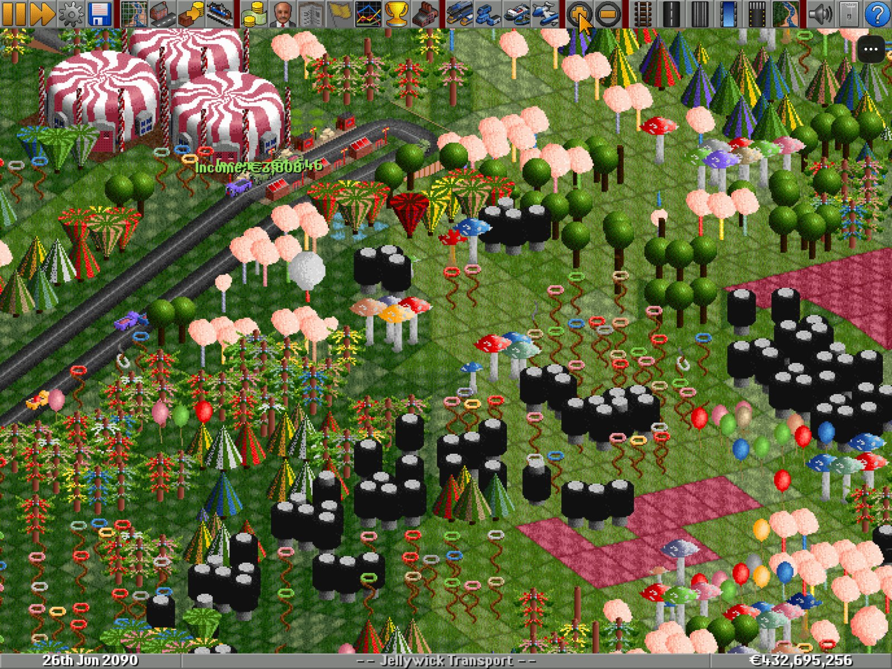
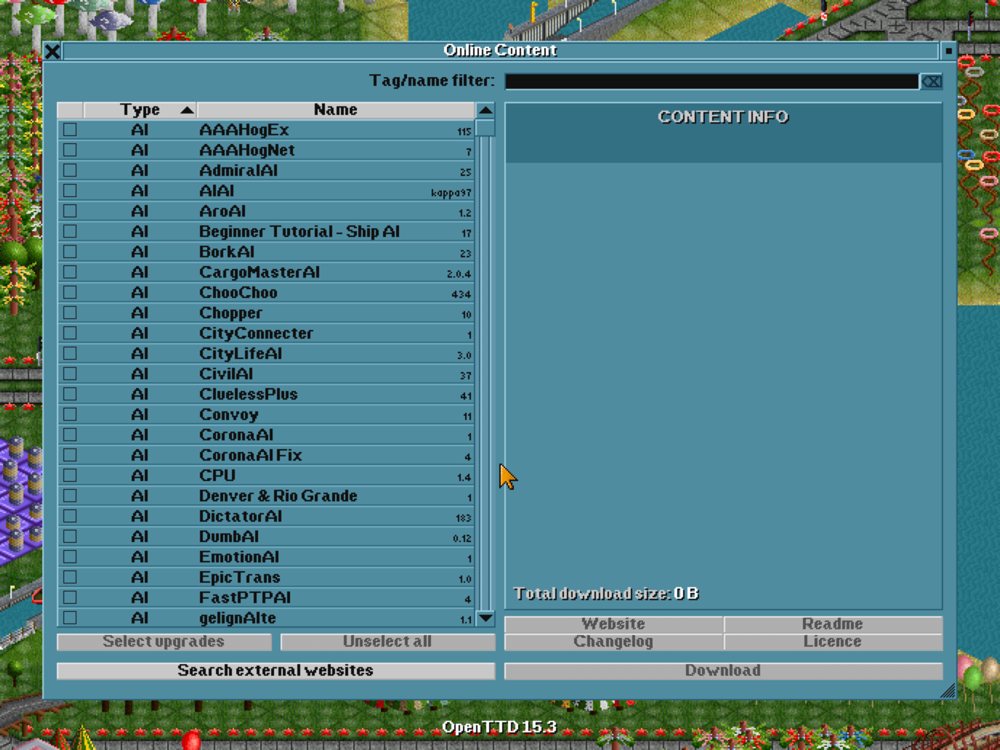

<p align="center">
  
</p>

<h1 align="center">OpenTTDPad</h1>

<p align="center">
  <strong>OpenTTD, native on iPad.</strong><br>
  Railways, roads, ships and planes, built with your fingers. Touch-first construction, a precision loupe,
  Apple Pencil, trackpad and keyboard, desktop-compatible saves, and free graphics, sound and music.
</p>

<p align="center">
  <a href="https://github.com/chrissotraidis/OpenTTDPad/releases/tag/v0.2.1"></a>
  
  
  
  
  
  <a href="LICENSE"></a>
  <a href="https://github.com/chrissotraidis/padmint"></a>
  <a href="https://discord.gg/xwHfUD2bxW"></a>
</p>

<p align="center">
  <a href="#get-openttdpad"><strong>Get OpenTTDPad</strong></a> ·
  <a href="#controls">Controls</a> ·
  <a href="#a-look-around">Screenshots</a> ·
  <a href="#status">Status</a> ·
  <a href="#frequently-asked-questions">FAQ</a>
</p>

<p align="center">
  
</p>

OpenTTDPad is an unofficial iPadOS port of [OpenTTD](https://www.openttd.org/),
the open-source transport simulation based on Transport Tycoon Deluxe. The
OpenTTD 15.3 simulation, economy, pathfinding and save format are untouched.
OpenTTDPad adds what an iPad needs: a gesture system that turns fingers into
OpenTTD actions, controls that stay out of the way, Files integration, native
MIDI music, international text, verified HTTPS for Online Content, and
reproducible builds.

> [!NOTE]
> **OpenTTDPad 0.2.0 is out.** [Download it](https://github.com/chrissotraidis/OpenTTDPad/releases/latest),
> build your own copy with [PadMint](https://github.com/chrissotraidis/padmint),
> or build from source. It's a preview: it plays on a physical iPad Pro with
> iPadOS 27, and Pencil, trackpad, keyboard and external displays still need
> testing on real hardware. [Tell us how it goes.](https://github.com/chrissotraidis/OpenTTDPad/issues/new/choose)

## Highlights

<table>
  <tr>
    <td width="50%"></td>
    <td width="50%"></td>
  </tr>
  <tr>
    <td valign="top"><strong>Build with your fingers.</strong> Pick a tool and drag to lay track, road or canal. A second finger or the Cancel button stops the tool without a stray placement.</td>
    <td valign="top"><strong>All of OpenTTD.</strong> Every game mode, the scenario editor, AI opponents, multiplayer and Online Content, with the free OpenGFX, OpenSFX and OpenMSX sets built in.</td>
  </tr>
  <tr>
    <td width="50%"></td>
    <td width="50%"></td>
  </tr>
  <tr>
    <td valign="top"><strong>Out of the way.</strong> The ⋯ button sits under the toolbar's Help button for saves, Files, touch settings and About. It steps aside when a game window docks in that corner.</td>
    <td valign="top"><strong>Yours to keep.</strong> Saves are ordinary OpenTTD 15.3 files. Export them all as a ZIP or import saves and content from Files.</td>
  </tr>
</table>

## Get OpenTTDPad

You need an iPad on iPadOS 17 or later, and about 65 MB of free space. Nothing
else: the free OpenGFX graphics, OpenSFX sounds and OpenMSX music are built in,
and no original Transport Tycoon Deluxe data is downloaded or bundled.

<details open>
<summary><strong>Download the app</strong> (easiest)</summary>

1. Download `OpenTTDPad-unsigned.ipa` from the
   [latest release](https://github.com/chrissotraidis/OpenTTDPad/releases/latest).
2. Install it with a sideloading tool that signs it with your own Apple ID, such
   as [Sideloadly](https://sideloadly.io/) (Mac or Windows) or
   [AltStore](https://altstore.io/). Developers can sign it with Xcode or `devicectl`.
3. Open OpenTTDPad and tap **New Game**.

With a free Apple ID, iPadOS stops opening sideloaded apps after seven days.
Refresh or reinstall over the existing app; your saves stay.

</details>

<details>
<summary><strong>Build your own copy with PadMint</strong> (Apple Silicon Mac)</summary>

With Xcode 26 or newer and its iOS platform installed, open
[PadMint](https://github.com/chrissotraidis/padmint) and choose **OpenTTDPad**.
There is no game file to pick. PadMint builds the latest release in about
10 minutes with about 4 GB of free space, and checks the result.

</details>

<details>
<summary><strong>Build from source</strong></summary>

You need an Apple Silicon Mac with Xcode, CMake, Ninja, Git, curl and unzip,
and about 10 GB of free space.

```sh
git clone https://github.com/chrissotraidis/OpenTTDPad.git
cd OpenTTDPad
./scripts/bootstrap-reference.sh   # pinned sources and free content
./scripts/build-device.sh
./scripts/package-ipa.sh           # build/artifacts/OpenTTDPad-unsigned.ipa
```

Sign and install the IPA as above. For the iPad Simulator, run
`./scripts/bootstrap-ios.sh` and then `./scripts/run-simulator.sh booted`.

</details>

**Updating:** install the new version over the existing app. Deleting
OpenTTDPad first also deletes its saves, settings and downloaded content.

## Controls

| Gesture | Result |
|---|---|
| Tap | Select, activate or place |
| Pinch | Zoom around the point between your fingers |
| Two-finger drag | Move the map, from anywhere |
| Drag with a construction tool | Build continuously |
| Drag a window | Move the window |
| Double-tap | Double-click |
| Two-finger tap | Secondary action (right-click) |
| Touch and hold | Precision loupe: move to aim, lift to tap |
| Second finger while building, or **Cancel** | Stop the tool without a stray placement |

The **⋯** button under the toolbar's Help button opens saves and Files, Touch
Controls (sensitivity, enlarged targets, left- or right-handed layout, haptics)
and About. Small OpenTTD buttons get touch targets of at least 44 points without
changing their look. Mouse, trackpad, scroll wheel and keyboard work as they do
in desktop OpenTTD.

## What's new in 0.2.0

- **Runs on iPadOS 27,** where earlier test builds opened to a black screen, and
  the game window follows its scene through rotation and external displays.
- **Taps land where your finger lands,** including window close boxes and other
  small buttons, and the precision loupe shows exactly the spot it will tap.
- **Fixed a pinch-zoom crash.**
- **Tidier controls,** the OpenTTD logo as the app icon, and an About page with
  links, credits and every license.

Full details are in the [release notes](docs/releases/v0.2.0.md).

## A look around

<table>
  <tr>
    <td width="50%"></td>
    <td width="50%"></td>
  </tr>
  <tr>
    <td align="center"><strong>Pinch to zoom</strong><br>From the whole map down to single trains</td>
    <td align="center"><strong>Online Content</strong><br>Thousands of free add-ons over verified HTTPS</td>
  </tr>
  <tr>
    <td width="50%"></td>
    <td width="50%" valign="middle"><strong>International text</strong><br>Every OpenTTD language, including right-to-left scripts.<br><br><sub>Screenshots: the release build on an iOS 27 iPad Pro 13-inch Simulator, playing OpenTTD's own title-screen game.</sub></td>
  </tr>
</table>

## Frequently asked questions

### Installing

<details>
<summary><strong>Is there an App Store version?</strong></summary>

No. Download the unsigned IPA and install it with Sideloadly, AltStore or Xcode,
or build your own copy with PadMint. No jailbreak is needed.

</details>

<details>
<summary><strong>It stopped opening after a week</strong></summary>

Apps signed with a free Apple ID expire after seven days. Refresh it in your
sideloading tool, or install the IPA again over the existing app; your saves and
settings are kept. A paid Apple Developer account signs for a year.

</details>

<details>
<summary><strong>Which iPads does it run on?</strong></summary>

Any iPad with iPadOS 17 or later, in landscape. It has been played on an iPad Pro
12.9-inch (6th generation) with iPadOS 27, and tested in the Simulator on iPad Pro,
iPad and iPad mini. iPhone is not supported.

</details>

<details>
<summary><strong>Do I need the original Transport Tycoon Deluxe?</strong></summary>

No. The free OpenGFX, OpenSFX and OpenMSX sets are built in, so a new game works
offline straight away. If you own the original game you can add its data
through OpenTTD's normal data folders; it is never bundled here.

</details>

### Playing

<details>
<summary><strong>How do I move around and zoom?</strong></summary>

Drag with two fingers to move the map and pinch to zoom. One finger taps,
builds and moves windows, so an accidental brush never scrolls you away. See
[Controls](#controls).

</details>

<details>
<summary><strong>Can I use a mouse, trackpad, keyboard or Apple Pencil?</strong></summary>

Yes. Mouse, trackpad, scroll wheel and keyboard shortcuts behave as in desktop
OpenTTD, and Apple Pencil works like a finger. These haven't been checked on
hardware for this release yet; reports are welcome.

</details>

<details>
<summary><strong>How do I get add-ons, scenarios and new vehicles?</strong></summary>

Tap **Online Content** on the title screen to browse OpenTTD's free catalog of
NewGRFs, AIs, scenarios and heightmaps. You can also import files with
**⋯ → Import Save or Content**.

</details>

<details>
<summary><strong>Does multiplayer work?</strong></summary>

OpenTTD's multiplayer code is unchanged, but joining or hosting a network game
from an iPad hasn't been tested yet.

</details>

<details>
<summary><strong>Does it work with an external display?</strong></summary>

The game window follows its scene to a connected display and adopts that
screen's resolution, the same fix the other Pad ports use. It has not been
checked with a physical monitor or Stage Manager yet.

</details>

### Saves and problems

<details>
<summary><strong>Where are my saves?</strong></summary>

In the Files app under **On My iPad → OpenTTDPad → OpenTTD → save**. **⋯ → Export
All Saves** shares them all as one ZIP, and **⋯ → Import Save or Content** brings
saves, scenarios and heightmaps in.

</details>

<details>
<summary><strong>Can I move games between my iPad and computer?</strong></summary>

Yes. Saves are ordinary OpenTTD 15.3 files. Export them and open them in desktop
OpenTTD 15.3, or import desktop saves the same way.

</details>

<details>
<summary><strong>The game crashed. What should I send?</strong></summary>

Open Files → On My iPad → OpenTTDPad → OpenTTD and attach the newest
`crash….json.log` and its `.png` to a
[bug report](https://github.com/chrissotraidis/OpenTTDPad/issues/new/choose). The
log records where the crash happened and why.

</details>

<details>
<summary><strong>Something is wrong in the game itself. Where do I report it?</strong></summary>

If it also happens in desktop OpenTTD, report it to
[OpenTTD](https://github.com/OpenTTD/OpenTTD/issues). Anything iPad-specific,
such as touch, layout, Files or crashes, belongs
[here](https://github.com/chrissotraidis/OpenTTDPad/issues/new/choose).

</details>

### About the project

<details>
<summary><strong>Is this an official OpenTTD release?</strong></summary>

No. OpenTTDPad is an independent community port, not affiliated with or
endorsed by the OpenTTD team.

</details>

<details>
<summary><strong>What does OpenTTDPad change in OpenTTD?</strong></summary>

Only the iPad layer: the app shell, touch input, on-screen controls, Files,
music playback and fonts. The simulation, economy, rules and save format are
OpenTTD 15.3's. Every edit to an upstream file is listed in
[docs/PATCHES.md](docs/PATCHES.md).

</details>

<details>
<summary><strong>Was AI used to make it?</strong></summary>

Yes. OpenTTDPad uses substantial AI assistance for code, tests, documentation,
debugging and maintenance. There is no audited percentage of AI-generated code;
build, test and device-acceptance records state what has actually been checked.
This describes OpenTTDPad's workflow, not the authorship of OpenTTD or its other
upstream projects.

</details>

## Status

| Area | State |
|---|---|
| Physical iPad | iPad Pro 12.9" (6th gen), iPadOS 27.2.1: games load and play by touch, music and saves work |
| Simulator | iOS 27 iPad Pro, iPad and iPad mini: touch, construction, settings, export and lifecycle tests pass |
| Engine | OpenTTD 15.3, gameplay and saves unchanged |
| Content | OpenGFX 8.0, OpenSFX 1.0.3, OpenMSX 0.4.2, TimGM6mb MIDI |
| Not yet checked on hardware | Pencil, trackpad, keyboard, external display, Bluetooth audio, multiplayer, long sessions |

Day-by-day evidence is in [docs/STATUS.md](docs/STATUS.md).

## Contributing

The most useful help right now is reports from real iPads: model, iPadOS
version, what you did, what happened, and a screenshot or crash log. Use the
[issue forms](https://github.com/chrissotraidis/OpenTTDPad/issues/new/choose) or
say hello on [Discord](https://discord.gg/xwHfUD2bxW).

For code, read [CONTRIBUTING.md](CONTRIBUTING.md); `./scripts/check-local.sh` runs
the full set of checks on a Mac.

<details>
<summary><strong>Project map</strong></summary>

| Path | Purpose |
|---|---|
| `engine/` | Pinned OpenTTD 15.3 plus isolated iOS and touch changes |
| `engine/src/os/ios/` | Scene delegate, on-screen controls, Files, haptics and settings |
| `engine/src/touch/` | Platform-neutral gesture recognizer and touch targets |
| `os/ios/` | App metadata and icon |
| `patches/` | Patches to the pinned SDL sources |
| `scripts/` | Bootstrap, build, package, test and release checks |
| `tests/ios-ui/` | XCTest UI scenarios |
| `docs/` | Architecture, touch design, status, [release notes](docs/releases/) and [releasing](docs/RELEASING.md) |
| `padmint.json` | PadMint build recipe |

</details>

## License

OpenTTDPad and OpenTTD are free software under the
[GNU General Public License version 2](LICENSE). Bundled content and libraries
keep their own compatible licenses, listed in
[THIRD_PARTY_NOTICES.md](THIRD_PARTY_NOTICES.md). Each release includes the
complete corresponding source.

OpenTTDPad is an independent community project. It is not an official OpenTTD
release and is not affiliated with or endorsed by OpenTTD, Transport Tycoon
Deluxe, or their respective rights holders.
